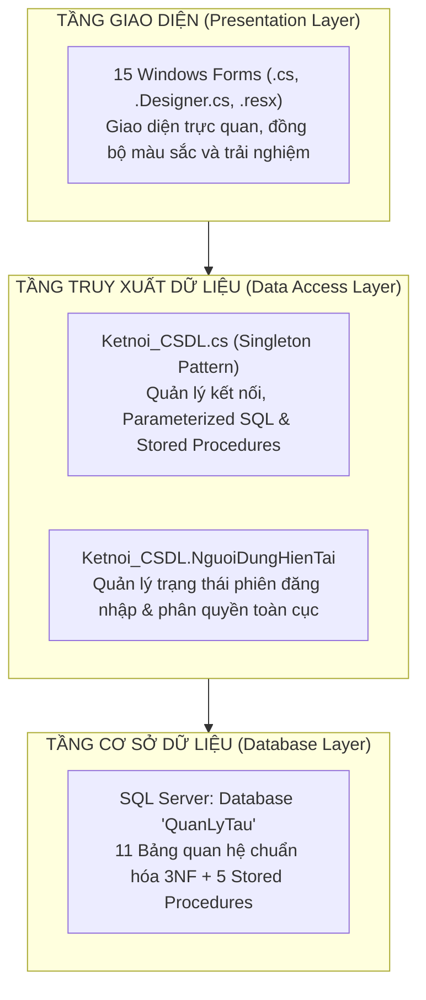
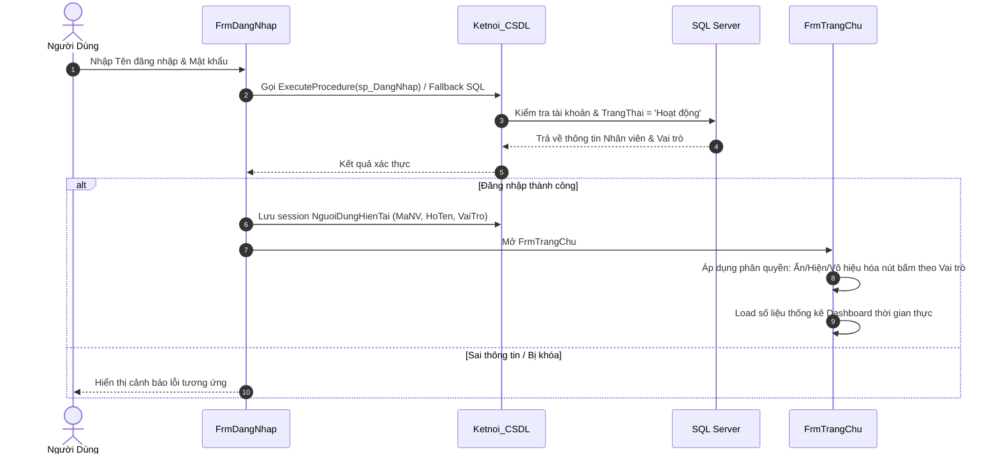
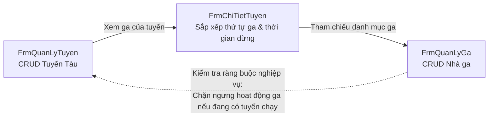
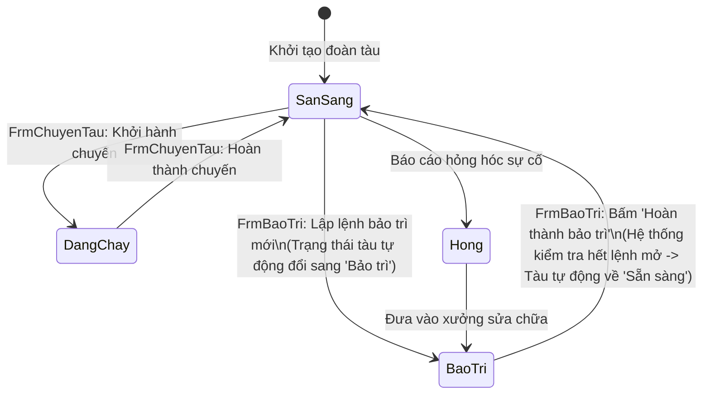
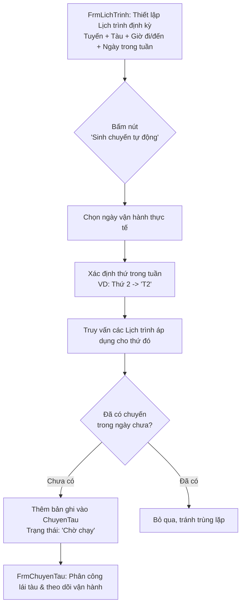

# BÁO CÁO TỔNG KẾT DỰ ÁN: HỆ THỐNG QUẢN LÝ TÀU ĐIỆN ĐÔ THỊ (SUBWAY MANAGEMENT SYSTEM)

---

## 1. TỔNG QUAN DỰ ÁN

### 1.1. Giới thiệu chung
Hệ thống **Quản Lý Tàu Điện Đô Thị (Subway Management System)** là giải pháp phần mềm toàn diện nhằm tin học hóa và tự động hóa toàn bộ quy trình vận hành đường sắt đô thị (Metro/Subway). Dự án được phát triển trên nền tảng **C# .NET Framework 4.7.2** kết hợp công nghệ **Windows Forms** và hệ quản trị cơ sở dữ liệu **Microsoft SQL Server**, tuân thủ nghiêm ngặt các yêu cầu nghiệp vụ theo tài liệu phân tích hệ thống (`BA_ERD.md`).

### 1.2. Mục tiêu dự án
* Quản lý tập trung hạ tầng đường ray, các tuyến metro và hệ thống nhà ga dừng đỗ.
* Giám sát tình trạng kỹ thuật, sức chứa và lịch sử bảo dưỡng định kỳ của đoàn tàu.
* Tự động hóa lịch trình vận hành và sinh chuyến tàu hằng ngày theo thứ trong tuần.
* Cung cấp giải pháp bán vé tại quầy (POS) nhanh chóng, tính giá linh hoạt theo cự ly chặng ga và hỗ trợ chính sách vé ưu tiên.
* Phân quyền chặt chẽ theo 4 nhóm vai trò người dùng trong doanh nghiệp: **Quản lý**, **Bán vé**, **Kỹ thuật**, **Lái tàu**.
* Cung cấp bảng điều khiển (Dashboard) và hệ thống báo cáo thống kê đa chiều phục vụ công tác ra quyết định.

---

## 2. KIẾN TRÚC HỆ THỐNG & CƠ SỞ DỮ LIỆU

### 2.1. Kiến trúc phân tầng (Layered Architecture)
Hệ thống được tổ chức theo mô hình phân tầng rõ ràng, đảm bảo tính mô-đun hóa, dễ bảo trì và mở rộng:



### 2.2. Sơ đồ thực thể liên kết CSDL (11 Bảng dữ liệu)
Hệ thống gồm 11 bảng được thiết kế chuẩn hóa và toàn vẹn tham chiếu:
1. **`NhanVien`**: Lưu trữ thông tin nhân viên, tài khoản, mật khẩu, vai trò và trạng thái công tác.
2. **`Tuyen`**: Danh mục tuyến tàu đô thị (hỗ trợ trạng thái Hoạt động / Ngưng hoạt động - Soft Delete).
3. **`Ga`**: Danh mục các nhà ga đón/trả khách.
4. **`Tuyen_Ga`**: Bảng trung gian định nghĩa lộ trình tuyến, thứ tự dừng đỗ (`ThuTu`) và thời gian dừng (`PhutDung`).
5. **`Tau`**: Danh sách đoàn tàu điện, tuyến phục vụ và trạng thái (`Sẵn sàng`, `Đang chạy`, `Bảo trì`, `Hỏng`).
6. **`ToaTau`**: Chi tiết các toa của từng đoàn tàu, loại toa (`Thường`/`Ưu tiên`) và sức chứa.
7. **`LichTrinh`**: Lịch vận hành định kỳ theo khung giờ và các ngày trong tuần (`T2,T3,T4,T5,T6,T7,CN`).
8. **`ChuyenTau`**: Các chuyến tàu cụ thể vận hành trong từng ngày thực tế, gán lái tàu và quản lý trạng thái (`Chờ chạy`, `Đang chạy`, `Hoàn thành`, `Hủy`).
9. **`HanhKhach`**: Thông tin định danh khách hàng qua số CCCD/CMND, họ tên và số điện thoại.
10. **`Ve`**: Vé tàu điện đã xuất xưởng, liên kết chuyến đi, ga đi/đến, loại vé, giá vé và trạng thái thanh toán.
11. **`BaoTri`**: Nhật ký lệnh sửa chữa, bảo dưỡng đoàn tàu, chi phí và kỹ thuật viên phụ trách.

---

## 3. CÁC QUY TRÌNH NGHIỆP VỤ CỐT LÕI (WORKFLOWS)

### 3.1. Quy trình 1: Xác thực đăng nhập & Phân quyền truy cập


### 3.2. Quy trình 2: Quản lý hạ tầng Tuyến - Ga dừng


### 3.3. Quy trình 3: Vòng đời bảo dưỡng kỹ thuật đoàn tàu
Hệ thống thiết lập cơ chế đồng bộ tự động 2 chiều giữa bảo trì và trạng thái đoàn tàu:


### 3.4. Quy trình 4: Lịch trình & Tự động sinh chuyến tàu


### 3.5. Quy trình 5: Bán vé POS & Tính cước tự động
```mermaid
flowchart TD
    Step1[1. Nhân viên chọn Chuyến tàu trong ngày] --> Step2[2. Hệ thống tải danh sách Ga dừng của Tuyến đó]
    Step2 --> Step3[3. Chọn Ga Đi và Ga Đến]
    Step3 --> Step4[4. Tính cự ly chặng: CuLy = ThuTuDen - ThuTuDi]
    Step4 --> CheckCuLy{Cự ly hợp lệ?\n(Ga đến > Ga đi)}
    CheckCuLy -- Không --> Err[Báo lỗi: Ga đến phải sau ga đi]
    CheckCuLy -- Hợp lệ --> Step5[5. Áp dụng bảng giá lũy tiến theo số chặng]
    Step5 --> Step6[6. Chọn loại vé: Thường / Ưu tiên\n(Ưu tiên giảm 30%)]
    Step6 --> Step7[7. Nhập số CCCD hành khách]
    Step7 --> LookupHK{Khách đã từng\nmua vé chưa?}
    LookupHK -- Có --> AutoFill[Tự động điền Họ tên & Số điện thoại]
    LookupHK -- Chưa --> NewHK[Nhập Họ tên mới]
    AutoFill --> Pay[8. Bấm 'Xuất & In Vé']
    NewHK --> Pay
    Pay --> Trans[Giao dịch SQL Transaction:\n- Lưu/Cập nhật HanhKhach\n- Tạo bản ghi Ve\n- Cập nhật số liệu bán]
    Trans --> Receipt[Hiển thị phiếu xác nhận in vé chi tiết]
```

---

## 4. CHI TIẾT DANH MỤC CHỨC NĂNG 15 MÀN HÌNH (FORMS)

| STT | Tên Form | Bộ 3 File thành phần | Đối tượng sử dụng | Mô tả chức năng & Nghiệp vụ chi tiết |
| :---: | :--- | :--- | :---: | :--- |
| **1** | **FrmDangNhap** | `FrmDangNhap.cs`<br>`FrmDangNhap.Designer.cs`<br>`FrmDangNhap.resx` | Tất cả | Xác thực tài khoản nhân viên qua `sp_DangNhap` (hoặc câu lệnh truy vấn an toàn). Kiểm tra mật khẩu, trạng thái tài khoản. Khởi tạo phiên làm việc `NguoiDungHienTai` và điều hướng sang Trang chủ. Hỗ trợ phím Enter tiện lợi. |
| **2** | **FrmTrangChu** | `FrmTrangChu.cs`<br>`FrmTrangChu.Designer.cs`<br>`FrmTrangChu.resx` | Tất cả | **Dashboard trung tâm**: Hiển thị 4 thẻ số liệu trực quan: Tàu điện sẵn sàng, Chuyến hôm nay, Vé bán hôm nay, Doanh thu hôm nay (tự động cập nhật thời gian thực). Menu 4 phân hệ được phân quyền nghiêm ngặt: vô hiệu hóa và đổi màu các nút ngoài phạm vi quyền. |
| **3** | **FrmQuanLyTuyen** | `FrmQuanLyTuyen.cs`<br>`FrmQuanLyTuyen.Designer.cs`<br>`FrmQuanLyTuyen.resx` | Quản lý | Quản lý danh mục tuyến tàu. Thêm mới, chỉnh sửa thông tin tuyến, mô tả lộ trình. Chức năng ngưng hoạt động (xóa mềm). Tìm kiếm tuyến theo từ khóa. Mở nhanh cấu hình chi tiết ga của tuyến đang chọn. |
| **4** | **FrmChiTietTuyen** | `FrmChiTietTuyen.cs`<br>`FrmChiTietTuyen.Designer.cs`<br>`FrmChiTietTuyen.resx` | Quản lý | Quản lý chi tiết lộ trình tuyến (`Tuyen_Ga`). Thêm ga vào tuyến, xóa ga khỏi tuyến. Điều chỉnh thứ tự đón khách (`ThuTu`) và thời gian dừng đỗ (`PhutDung`). Tự động đánh lại số thứ tự liên tục khi có điều chỉnh. |
| **5** | **FrmQuanLyGa** | `FrmQuanLyGa.cs`<br>`FrmQuanLyGa.Designer.cs`<br>`FrmQuanLyGa.resx` | Quản lý | Quản lý danh mục nhà ga đô thị. Thêm mới, cập nhật thông tin ga. **Ràng buộc nghiệp vụ**: Chặn ngưng hoạt động ga nếu nhà ga đó đang nằm trên tuyến tàu đang hoạt động. |
| **6** | **FrmQuanLyTau** | `FrmQuanLyTau.cs`<br>`FrmQuanLyTau.Designer.cs`<br>`FrmQuanLyTau.resx` | Quản lý,<br>Kỹ thuật | Quản lý đoàn tàu điện. Hiển thị tuyến hoạt động, trạng thái tàu, tổng số toa và **tổng sức chứa khách** (tính toán động từ bảng `ToaTau`). Lọc danh sách theo trạng thái (`Sẵn sàng`, `Đang chạy`, `Bảo trì`, `Hỏng`) hoặc theo tuyến. Mở cấu hình toa tàu. |
| **7** | **FrmChiTietTau** | `FrmChiTietTau.cs`<br>`FrmChiTietTau.Designer.cs`<br>`FrmChiTietTau.resx` | Quản lý,<br>Kỹ thuật | Quản lý các toa tàu của đoàn tàu. Thêm toa mới, chỉnh sửa loại toa (`Thường`, `Ưu tiên`), cập nhật sức chứa từng toa. Thống kê tổng quan số toa và tổng chỗ ngồi của đoàn tàu. |
| **8** | **FrmBaoTri** | `FrmBaoTri.cs`<br>`FrmBaoTri.Designer.cs`<br>`FrmBaoTri.resx` | Quản lý,<br>Kỹ thuật | Quản lý bảo dưỡng sửa chữa. Tạo lệnh bảo trì mới ➔ **Đoàn tàu tự động chuyển sang trạng thái 'Bảo trì'**. Cập nhật chi phí, nội dung. Nút 'Hoàn thành' ➔ Ghi nhận ngày kết thúc, kiểm tra hết lệnh mở ➔ **Đoàn tàu tự động phục hồi về trạng thái 'Sẵn sàng'**. |
| **9** | **FrmLichTrinh** | `FrmLichTrinh.cs`<br>`FrmLichTrinh.Designer.cs`<br>`FrmLichTrinh.resx` | Quản lý | Cấu hình lịch vận hành định kỳ theo tuyến, tàu, giờ đi/đến và chọn các ngày trong tuần (`T2..CN`). **Công cụ sinh chuyến**: Tự động duyệt lịch và sinh các chuyến tàu tương ứng vào bảng `ChuyenTau` cho bất kỳ ngày nào được chọn, chống trùng lặp. |
| **10** | **FrmChuyenTau** | `FrmChuyenTau.cs`<br>`FrmChuyenTau.Designer.cs`<br>`FrmChuyenTau.resx` | Quản lý,<br>Bán vé,<br>Lái tàu | Quản lý danh sách chuyến tàu chạy theo từng ngày. Phân công nhân viên lái tàu. Cập nhật chuyển đổi trạng thái chuyến: `Chờ chạy` ➔ `Đang chạy` ➔ `Hoàn thành` / `Hủy`. **Chế độ Lái tàu**: Tự động lọc chỉ hiển thị các chuyến được phân công cho chính lái tàu đó. |
| **11** | **FrmBanVe** | `FrmBanVe.cs`<br>`FrmBanVe.Designer.cs`<br>`FrmBanVe.resx` | Quản lý,<br>Bán vé | Điểm bán vé quầy (POS). Chọn chuyến theo ngày, chọn ga đi/đến. Tự động tính chặng di chuyển và đơn giá vé. Giảm giá 30% cho vé ưu tiên. Tự động tra cứu khách hàng qua CCCD, tự tạo khách mới trong giao dịch SQL an toàn (Transaction). Xuất phiếu vé xác nhận. |
| **12** | **FrmTraCuuVe** | `FrmTraCuuVe.cs`<br>`FrmTraCuuVe.Designer.cs`<br>`FrmTraCuuVe.resx` | Quản lý,<br>Bán vé | Tra cứu vé đã phát hành theo Mã vé, số CCCD hành khách hoặc theo khoảng thời gian mua vé. Xem chi tiết thông tin hành trình. Hỗ trợ hủy vé chưa sử dụng với hộp thoại xác nhận an toàn. |
| **13** | **FrmHanhKhach** | `FrmHanhKhach.cs`<br>`FrmHanhKhach.Designer.cs`<br>`FrmHanhKhach.resx` | Quản lý,<br>Bán vé | Quản lý khách hàng thân thiết. Tìm kiếm theo họ tên, CCCD, số điện thoại. Hiển thị tổng số vé đã mua và tổng chi tiêu. Mô hình **Master-Detail**: Nhấp chọn hành khách để xem ngay lưới toàn bộ lịch sử các vé đã mua. |
| **14** | **FrmNhanVien** | `FrmNhanVien.cs`<br>`FrmNhanVien.Designer.cs`<br>`FrmNhanVien.resx` | Quản lý | Quản lý danh sách nhân sự và tài khoản hệ thống. Thêm nhân viên, gán vai trò (`QuanLy`, `BanVe`, `KyThuat`, `LaiTau`), kiểm tra chống trùng lặp username. Hỗ trợ cập nhật thông tin, trạng thái hoạt động và đặt lại mật khẩu mặc định (`123456`). |
| **15** | **FrmBaoCao** | `FrmBaoCao.cs`<br>`FrmBaoCao.Designer.cs`<br>`FrmBaoCao.resx` | Quản lý | Hệ thống báo cáo thống kê chuyên sâu gồm 3 Tab:<br>• **Tab 1**: Thống kê doanh thu, số vé bán, vé hủy theo khoảng ngày/tháng kèm bảng chi tiết từng ngày.<br>• **Tab 2**: Doanh thu lũy kế theo từng tuyến tàu, số chuyến và sản lượng vé.<br>• **Tab 3**: Báo cáo tổng hợp số lượt bảo trì, tổng chi phí kỹ thuật theo khoảng ngày hoặc theo từng đoàn tàu. |

---

## 5. MA TRẬN PHÂN QUYỀN HỆ THỐNG (ROLE-BASED ACCESS CONTROL)

Hệ thống triển khai cơ chế kiểm soát truy cập dựa trên vai trò (RBAC) với 4 nhóm người dùng:

| Chức năng / Màn hình | Quản Lý (`QuanLy`) | Bán Vé (`BanVe`) | Kỹ Thuật (`KyThuat`) | Lái Tàu (`LaiTau`) |
| :--- | :---: | :---: | :---: | :---: |
| **Đăng nhập & Trang chủ Dashboard** | ✔ | ✔ | ✔ | ✔ |
| **Quản lý Tuyến & Chi tiết Ga dừng** | ✔ | ✖ | ✖ | ✖ |
| **Quản lý Danh mục Ga tàu** | ✔ | ✖ | ✖ | ✖ |
| **Quản lý Tàu điện & Chi tiết Toa** | ✔ | ✖ | ✔ | ✖ |
| **Lập & Hoàn thành Phiếu bảo trì** | ✔ | ✖ | ✔ | ✖ |
| **Cấu hình Lịch trình & Sinh chuyến** | ✔ | ✖ | ✖ | ✖ |
| **Quản lý Chuyến tàu** | ✔ | ✔ (Xem) | ✖ | ✔ (Chuyến phân công) |
| **Bán vé tại quầy (POS)** | ✔ | ✔ | ✖ | ✖ |
| **Tra cứu & Hủy vé** | ✔ | ✔ | ✖ | ✖ |
| **Quản lý Hành khách & Lịch sử đi tàu** | ✔ | ✔ | ✖ | ✖ |
| **Quản lý Nhân viên & Phân quyền** | ✔ | ✖ | ✖ | ✖ |
| **Báo cáo Thống kê Doanh thu & Kỹ thuật** | ✔ | ✖ | ✖ | ✖ |

### Danh sách tài khoản thử nghiệm tích hợp sẵn trong CSDL:
* **Tài khoản Quản lý**: `admin` / Mật khẩu: `123456` (Toàn quyền hệ thống)
* **Tài khoản Bán vé**: `banve` / Mật khẩu: `123456` (Vận hành bán vé, tra cứu, hành khách)
* **Tài khoản Kỹ thuật**: `kythuat` / Mật khẩu: `123456` (Đoàn tàu, toa tàu, bảo trì thiết bị)
* **Tài khoản Lái tàu**: `laixe` / Mật khẩu: `123456` (Xem lịch trình chuyến tàu được phân công)

---

## 6. NHỮNG THÀNH TỰU KỸ THUẬT NỔI BẬT ĐÃ ĐẠT ĐƯỢC

1. **Chuẩn hóa 100% cấu trúc tệp tin Windows Forms**:
   * Tất cả 15 Form đều được cấu thành chuẩn xác từ 3 tệp tin vật lý (`.cs`, `.Designer.cs`, `.resx`), tổng cộng 45 tệp form hoàn chỉnh, tương thích tuyệt đối với Visual Studio Form Designer.
2. **Biên dịch sạch sẽ (Clean Build)**:
   * Toàn bộ Solution `QuanLyTau.sln` biên dịch bằng MSBuild đạt kết quả: **`0 Warning(s), 0 Error(s)`**.
3. **Cơ chế Fallback thông minh & Chống SQL Injection**:
   * Lớp `Ketnoi_CSDL.cs` sử dụng `SqlCommand` với `SqlParameter` 100%, triệt tiêu nguy cơ tấn công SQL Injection.
   * Hệ thống tự động kiểm tra nếu có Stored Procedures thì thực thi, nếu chưa có thì kích hoạt truy vấn tham số hóa tương đương, giúp ứng dụng có thể chạy ngay trên CSDL gốc mà không sợ lỗi thiếu thủ tục.
4. **Xử lý toàn vẹn dữ liệu trong giao dịch (Transaction Management)**:
   * Chức năng bán vé quầy POS áp dụng `SqlTransaction`, đảm bảo tính nguyên tố (Atomic): nếu thêm khách hàng hoặc xuất vé phát sinh lỗi thì toàn bộ giao dịch được Rollback an toàn, không sinh dữ liệu rác.
5. **Giao diện người dùng hiện đại, khoa học**:
   * Bảng màu phẳng (Flat Color Palette) chuyên nghiệp: Xanh dương (Hạ tầng), Xanh mòng két (Kỹ thuật), Cam (Bán vé), Tím (Quản trị).
   * Đã gỡ bỏ toàn bộ số thứ tự thô trên các nút bấm chính để mang lại trải nghiệm tinh tế, chuẩn mực.
   * Dashboard hiển thị số liệu thống kê thời gian thực từ CSDL.

---

## 7. HƯỚNG DẪN CÀI ĐẶT & THỰC THI DỰ ÁN

1. **Bước 1: Khởi tạo Cơ sở dữ liệu**
   * Mở SQL Server Management Studio (SSMS).
   * Mở tệp `QuanLyTau.sql` và nhấn **Execute (F5)** để tạo CSDL và 11 bảng cùng dữ liệu mẫu ban đầu.
   * *(Khuyên dùng)* Mở tệp `BoSung_StoredProcedures.sql` và nhấn **Execute (F5)** để nạp 5 Stored Procedures tối ưu hóa.
2. **Bước 2: Kiểm tra Chuỗi kết nối**
   * Mở tệp `App.config`, kiểm tra giá trị `connectionString`. Mặc định kết nối tới `.\SQLEXPRESS` với quyền Windows Authentication:
     ```xml
     <connectionStrings>
       <add name="QuanLyTauConn" 
            connectionString="Data Source=.\SQLEXPRESS;Initial Catalog=QuanLyTau;Integrated Security=True;Encrypt=False" 
            providerName="System.Data.SqlClient" />
     </connectionStrings>
     ```
3. **Bước 3: Mở & Khởi chạy dự án**
   * Nhấp đúp vào tệp `QuanLyTau.sln` để mở trong Visual Studio.
   * Nhấn **F5** (hoặc nút **Start**) để khởi chạy chương trình.
   * Đăng nhập với tài khoản `admin` / `123456` để trải nghiệm toàn bộ hệ thống.
